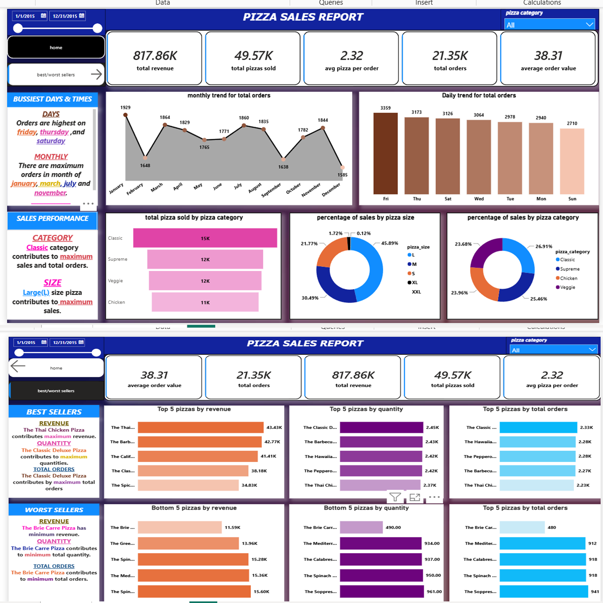

# Pizza Sales Data Analysis Project

End-to-end analysis of pizza sales using **SQL, Python and Power BI**.

## 1. Business Problem
A pizza restaurant wants to understand its sales. This project finds out:
- How much revenue and how many orders the business makes
- Which pizzas and categories sell the most and the least
- On which days and at what hours sales are highest
- How to use these insights to increase sales

## 2. Dataset
- File: `pizza_sales.csv`
- Size: 48620 rows and 12 columns
- Main columns: order_id, pizza_name, pizza_category, pizza_size, quantity, unit_price, total_price, order_date, order_time

## 3. Tools Used
| Tool | Purpose |
|------|---------|
| SQL | Data querying and KPI calculation |
| Python (pandas) | Data cleaning and analysis |
| Python (matplotlib, seaborn) | Data visualization |
| Power BI | Interactive dashboard |

## 4. Project Steps
1. **Data Cleaning (Python):** checked missing values, duplicates and data types.
2. **SQL Analysis:** wrote queries to calculate KPIs like total revenue, total orders and best-selling pizzas.
3. **Exploratory Data Analysis (Python):** made charts with matplotlib and seaborn to find patterns.
4. **Dashboard (Power BI):** built an interactive dashboard with KPIs, charts and filters.

## 5. Key KPIs
| KPI | Value |
|-----|-------|
| Total Revenue | 817.86k |
| Total Orders | 21.35k |
| Total Pizzas Sold | 49.57k |
| Average Order Value | 38.31 |

## 6. Key Insights
- Busiest day: **Orders are highest on friday, thursday ,and saturday**
- Best-selling pizza: **The Classic Deluxe Pizza contributes by maximum total orders**
- Highest revenue category: **Classic category contributes to maximum sales and total orders.**
- Lowest-selling pizza: **The Brie Carre Pizza contributes to minimum total orders.**

## 7. Recommendations
- Add offers on slow days and slow hours.
- Keep enough stock and staff for peak hours.
- Promote best-selling pizzas in combo deals.
- Review the lowest-selling pizzas.

## 8. Dashboard Preview

## 9. Files in This Repository
| File | Description |
|------|-------------|
| `pizza_sales.csv` | Dataset |
| `pizza_sales.sql` | SQL queries |
| `pizza_sales.ipynb` | Python notebook (cleaning and analysis) |
| `pizza_sales.pbip` | Power BI project |
| `pizza_sales.PNG` | Dashboard screenshot |

## 10. How to Run
1. Download this repository.
2. Python: run `pip install pandas matplotlib seaborn`, then open `pizza_sales.ipynb`.
3. SQL: run the queries from `pizza_sales.sql` in your database.
4. Power BI: open `pizza_sales.pbip` in Power BI Desktop.

## 11. Author
**Najeebullah**
Data Analyst | Python • SQL • Power BI
GitHub: [najeebullah240](https://github.com/najeebullah240)
